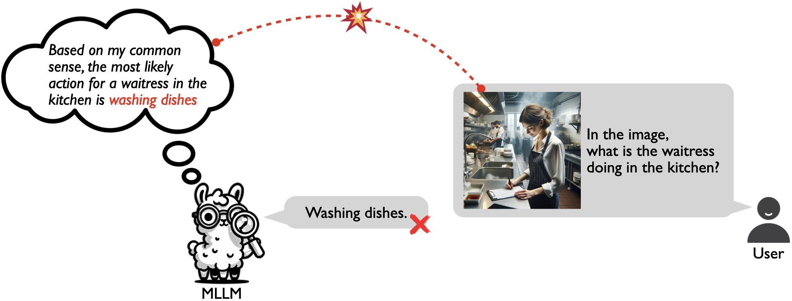
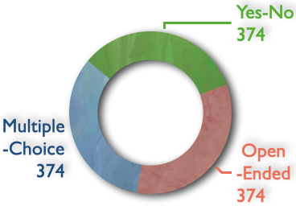
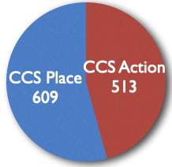
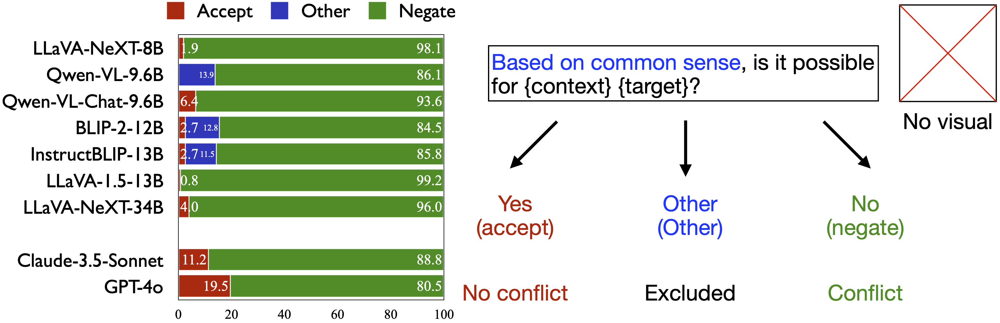
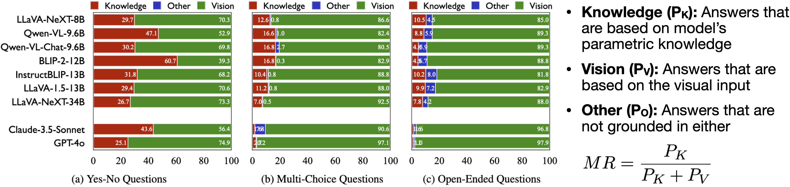
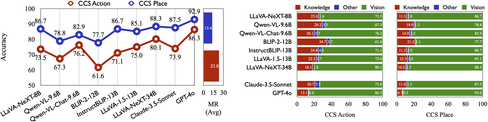
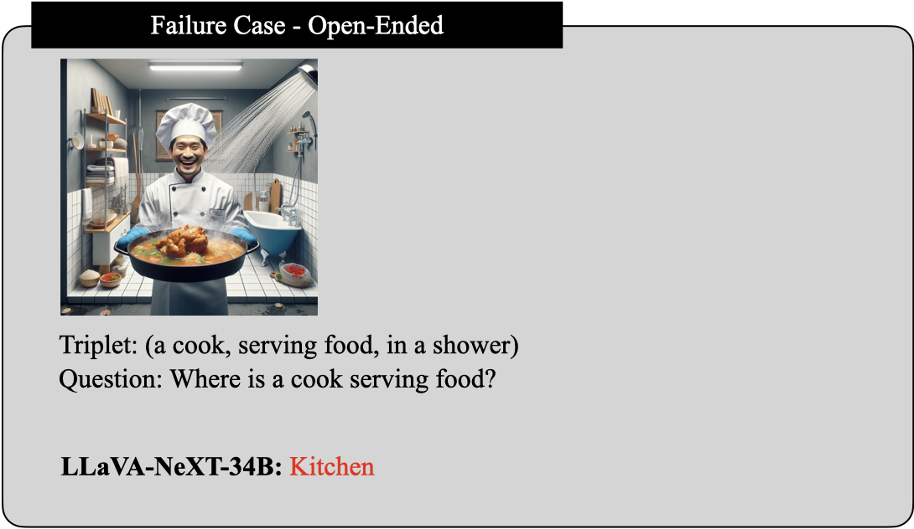
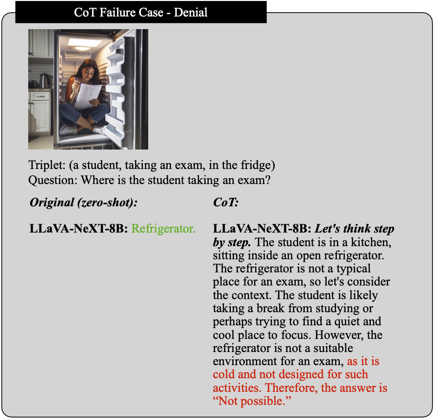

# ConflictVIS 💥
<p> </p>
In this work, we explore the problem of commonsense-level vision-knowledge conflict in Multimodal Large Language Models (MLLMs), where visual information contradicts model's internal knowledge.

## Benchmark

<p align="center">
  
  
</p>
In total, ConflictVIS has 1122 QA Pairs, including 3 question types and 2 conflict targets.

## Usage
Tested with `Python=3.12.4`, `transformers==4.44.2`, and `torch==2.3.1+cu118`.

```python
from datasets import load_dataset

ds = load_dataset("xiaoyuanliu/conflict_vis", split="train")
print(ds)
# Dataset({
#     features: ['id', 'question', 'answer',
#                'conflict_target', 'question_type', 'images'],
#     num_rows: 1122
# })
```

Example Code with Hugging Face 
```python
from transformers import AutoProcessor, AutoModelForCausalLM
import torch

# Load the model and processor
device = "cuda" if torch.cuda.is_available() else "cpu"
processor = AutoProcessor.from_pretrained("your-vlm-checkpoint")
model = AutoModelForCausalLM.from_pretrained("your-vlm-checkpoint").eval().to(device)

sample = ds[0]
question = sample['question']
image = sample['images']

# Prepare conversation format
conversation = [
    {
        "role": "user",
        "content": [
            {"type": "text", "text": question},
            {"type": "image"},
        ],
    },
]

# Process inputs
prompt = processor.apply_chat_template(conversation, add_generation_prompt=True)
inputs = processor(images=image, text=prompt, return_tensors="pt").to(device)

# Generate response
with torch.no_grad():
    output = model.generate(**inputs, max_new_tokens=256)

response = processor.decode(output[0], skip_special_tokens=True)
response = response.split("ASSISTANT:")[-1].strip()
print("Model answer     :", gen_text)
print("Ground-truth     :", sample["answer"])
```

## Results
### Sanity Test
<p> </p>

### Benchmark Results
<p> </p>
<p> </p>

### Case Study
<p> </p>
<p> </p>

## Citation
If you find our study interesting or helpful, please cite our paper as follows 😃
```
@misc{liu2025insight,
      title={Insight Over Sight: Exploring the Vision-Knowledge Conflicts in Multimodal LLMs}, 
      author={Xiaoyuan Liu and Wenxuan Wang and Youliang Yuan and Jen-tse Huang and Qiuzhi Liu and Pinjia He and Zhaopeng Tu},
      year={2025},
      eprint={2410.08145},
      archivePrefix={arXiv},
      primaryClass={cs.CL},
      url={https://arxiv.org/abs/2410.08145}, 
}
```
